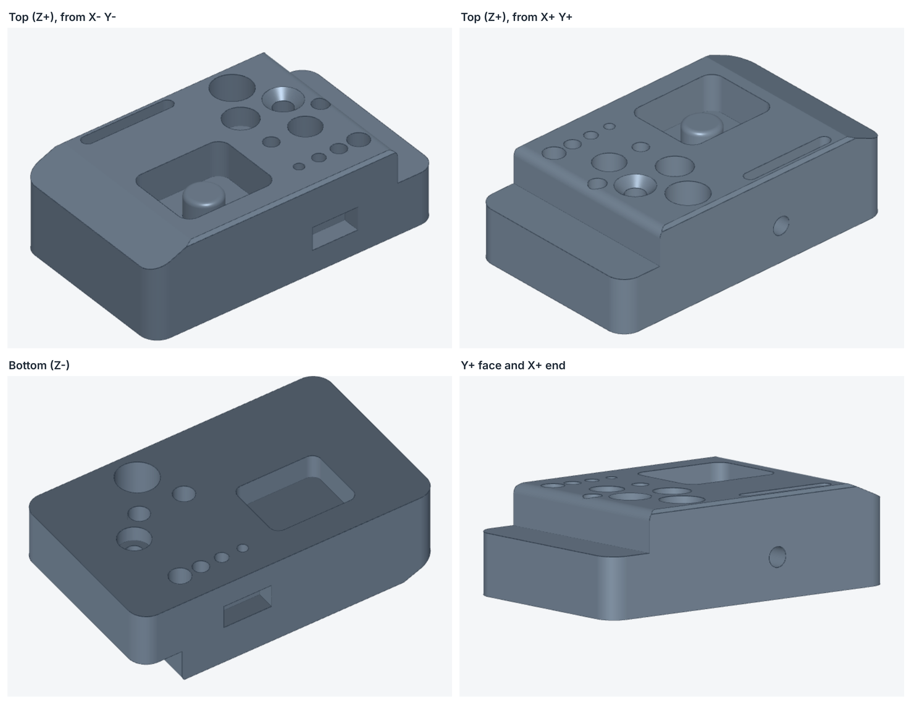

# CAM AI test part

One block with every kind of operation CAM AI plans, to test it and to troubleshoot on: when something looks wrong
on a real part, make this one and see whether the same thing happens here, on a part whose every feature is known.

- **Model**: `tests/models/cam-test-part.stl` (binary STL, 12,186 triangles, closed: 8 holes through).
- **Made by**: `tools/test-part/make_test_part.py` (manifold3d); change a feature there and run it again.
- **Checked by**: `tests/camTestPart.test.ts` (what CAM AI reads from it: holes, floors, chamfers, the 3D surface).
- **On the CAM AI page**: choose the STL, the material, the machine; the page's blank (+4, +4, +7) is
  104 x 64 x 37. Try ALU and POM: the plunges, the vise check and the cutting data differ.

## Features

100 x 60 x 30 mm, its corner at the origin, Z up (the top is Z+). Positions are the feature's centre or extent.

| # | Feature | Where (mm) | What CAM AI should do |
|---|---|---|---|
| 1 | Top face | z 30 | Face it (PLAN), 2 mm of blank |
| 2 | Outline 100 x 60, vertical corners R6 | | Cut it whole in clamping 1, 0.5 mm under the part (FRAESEN, before the drills) |
| 3 | 1 x 45° chamfer round the top edge | | Chamfer it (FASE, the 90° graver) |
| 4 | Slope at the X- end, 23° | x 0..14, from z 24 up to the top | A 3D surface: noted as left ("surface"), the ball end mill's |
| 5 | Step at the X+ end, open on three sides | x 86..100, 12 deep (z 18) | Mill it with the outline's mill, its floor a level |
| 6 | R3 round on the step's top edge | x 86, z 30 | A rounded edge: noted today (the corner-rounding mill's) |
| 7 | Pocket 32 x 26, inside corners R4, 12 deep | x 18..50, y 8..34 | Pocket (FRAESEN), corners at the pocket mill's radius |
| 8 | Island Ø12 in the pocket, 8 high, R1.5 round on top | x 34, y 21 | Mill round it; its round noted |
| 9 | Slot 4 wide, 32 long, 6 deep | x 18..50, y 54..58 | A small mill; the 2 mm wall to the Y+ face (thin wall) |
| 10 | Through holes Ø3.3, Ø4.2, Ø5, Ø6.8 | y 10, x 59, 66, 73, 80 | Spot drill (under Ø4), drill through (G83) |
| 11 | Blind hole Ø5, 15 deep, 118° point | x 60, y 24 | Drill to the point (0.3 x Ø lower) |
| 12 | Blind hole Ø10, 8 deep, flat bottom | x 72, y 24 | Drilled where a Ø10 is, else milled |
| 13 | Counterbore Ø11 x 6.5 on a Ø6.6 hole through, from the top | x 60, y 38 | Both in one clamping (the counterbore milled: no Ø11 drill) |
| 14 | Countersink 90° to Ø12 on a Ø6.4 hole through | x 75, y 38 | Drill, then the countersink as a 45° chamfer (graver) |
| 15 | Hole Ø13 through | x 67, y 51 | No Ø13 drill: milled, the drill listed as missing |
| 16 | Pocket 28 x 22, R3, 8 deep, in the bottom | x 20..48, y 10..32 | Clamping 2 (Z-): facing, the pocket |
| 17 | Counterbore Ø10 x 5 in the bottom on a Ø5.5 hole through | x 82, y 30 | The Ø5.5 drilled from the bottom, with its counterbore (one clamping) |
| 18 | Hole Ø6, 15 deep, in the Y+ face | x 40, z 12 | A clamping on that edge (Y+ up) |
| 19 | Slot 16 x 8, 6 deep, in the Y- face | x 56..72, z 8..16 | A clamping on the other edge (Y- up): a pocket open to that face only |

## Baseline (c465625, the page's defaults, ALU, CAM AI's own tool library)

| Clamping | Parallels / grip | Operations |
|---|---|---|
| 1, Z+ | 41 mm / 4 | PLAN, FRAESEN_16MM (outline), ZENTRIERBOHREN, BOHREN 3.3, 4.2, 5, 10, 6.4, FRAESEN 16, 8, 6, 5, 4, 3, FASE, ENTGRATEN |
| 2, Z- | 20 mm / 25 | PLAN, BOHREN 10, 5.5 (the counterbore and its hole), FRAESEN 16, 8, ENTGRATEN |
| 3, Y- | 42 mm / 3 | FRAESEN 16, 8 (the side slot), FASE, ENTGRATEN |
| 4, Y+ | 15 mm / 30 | FRAESEN 16, 6 (the side hole), FASE, ENTGRATEN |

20,533 lines, 36.6 minutes (the app's time model), the simulated part like the model (match 1), no collision, no
clamping misplaced, nothing cut into the part. Noted: three surfaces left (the slope, the two rounds) and one hole
narrow at its far end. Listed as missing: drills Ø6.8, Ø6.6, Ø11, Ø13, Ø6 (those holes are milled) and a Ø1 mill.
Planned in 877 s on the test machine (another plan running beside it).

## What it already shows

- **Clamping 3 (Y-) is gripped 3 mm on 42 mm parallels**, the part standing 60 mm tall, for a slot 6 deep at its
  top: the grip should be far deeper (your rule: as deep as the cuts allow). To look into.
- **Planning takes minutes** (877 s here): the one-face-one-clamping re-plan and the vise retries plan clampings
  again. To look into before the page's users wait that long.
- The slope and the rounds are left (no ball end mill or corner-rounding mill yet).
